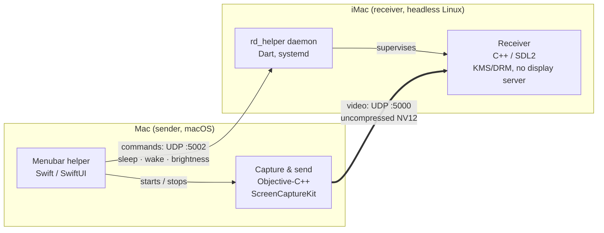

# remoteDisplay

**Turn a Retina iMac into a real external display for your Mac — over a single Thunderbolt cable, entirely in software, with no hardware modification.**

4K at 60 frames per second, uncompressed, about 20–30 ms behind the Mac's own screen. Plug the cable in and the iMac becomes a screen. Put the Mac to sleep and the iMac's panel actually turns off. Move the brightness slider and it follows. It is my only display, every day.

<!-- TODO: demo video here (plug the cable → the display appears, typing, sleep/wake) -->

---

## Why this exists

I had a 2017 21.5" iMac with a beautiful 4K panel and a resale value that collapsed the day Apple Silicon shipped. Throwing that panel away felt wrong.

The usual options are all bad:

- **Target Display Mode** was never supported on Retina iMacs.
- **Conversion boards** mean opening the iMac and replacing its display electronics.
- **Screen-sharing tools** (VNC, Sunshine…) compress the stream to save bandwidth. On a desk, as your main screen, you feel that latency on every keystroke.

But a Thunderbolt 3 link between two Macs is a very fast network. At 4096 × 2304 and 60 fps, raw NV12 video is about 6.8 Gbit/s, and the link has room for it. So the idea was simple: **don't compress at all**, and make everything else fast enough that the iMac behaves like a display rather than a remote desktop.

## What it feels like

The goal was never "stream my screen". It was "the user shouldn't notice this isn't a normal monitor":

| You do this on the Mac | The iMac does this |
|---|---|
| Plug in the Thunderbolt cable | Streaming starts on its own |
| Unplug the cable | Streaming stops, the panel turns off |
| Mac goes to sleep | The panel really powers down (backlight included) |
| Mac wakes up | The panel comes back, brightness restored |
| Move the brightness slider in the menubar | The iMac's backlight follows |

## How it works

**On the Mac**, a small menubar app watches the network path for the Thunderbolt bridge interface. When it comes up, the app enables a virtual display (via [BetterDisplay](https://github.com/waydabber/BetterDisplay)) and launches the sender. The sender captures that display with **ScreenCaptureKit**, cuts each frame into chunks and sends them over UDP. The app also listens for system sleep and wake, offers a brightness slider, and forwards both to the iMac as commands.

**On the iMac**, there is no desktop at all. A headless Dart daemon, started by systemd, supervises the C++ receiver: it restarts it if it crashes, and turns the panel on and off on command. The receiver draws directly to the screen through **KMS/DRM** — no X11, no Wayland in the way.

## Design decisions

### 1. No compression — tried before, and removed

I tried two ways around raw frames. **LZ4 compression**, first a standard implementation, then Apple's own: both went out the same day. **NDI**, as the transport: dropped as well. Both gave the same result — latency I could see on every keystroke, for bandwidth I didn't need. Every existing tool I had rejected shared that same trade-off. So the pipeline sends raw frames and spends its effort elsewhere.

### 2. Chonky datagrams (Jumbo MTU)

A 4096 × 2304 NV12 frame is about 13.5 MiB. It is cut into chunks of 65,000 bytes (~218 per frame), each carried in one UDP datagram behind a small custom header (`frameId`, `chunkId`, `totalChunks`, dimensions, size, format).

The first version displayed nothing, or one frame every four seconds. The cause was the MTU: at the default 1,500 bytes, each 65 KB datagram was fragmented into ~44 IP fragments, and losing any one of them discarded the whole datagram. Raising the Thunderbolt interface to a jumbo MTU (65,520) makes one datagram travel as a single packet on the wire.

### 3. Better late than never... Actually, no !

There is no retransmission, no FEC, no acknowledgement. For a display, a frame that arrives late is worse than no frame at all. The receiver only shows a frame once every chunk has arrived; when a chunk from a newer frame shows up, the incomplete one is abandoned. If the socket buffer ever backs up past ~2 frames (28 MiB), it is drained entirely and the receiver resumes on a fresh frame rather than displaying the past.

### 4. Two threads and one mailbox

The receiver is split into two threads, each pinned to its own CPU core and running under real-time scheduling (`SCHED_FIFO`):

- **Network thread** — does nothing but drain the socket (up to 64 datagrams per `recvmmsg` call) and reassemble frames. It never waits on the display.
- **Display thread** — takes the most recent complete frame and presents it on the panel's vertical blank.

They exchange frames through a **three-slot mailbox**: the network thread writes one slot, the display thread reads another, and the third is the hand-off. The display always gets the freshest frame; frames the panel can't show in time are silently skipped.

Before this split, I had to choose between tearing (no VSync) and stutter (with VSync, the render call blocked the main loop, the socket filled up, and the receiver had to flush). Separating the two removed both.

On top of that, the display thread uses **late-latching**: instead of rendering as soon as a frame is ready, it sleeps until just before the next vertical blank, then grabs the freshest frame, renders it and presents it just in time. Its time budget adjusts itself, and the display runs double-buffered rather than with SDL's default triple buffering, which would add a frame of delay.

### 5. Memory allocation is our enemy

On the Mac, each captured frame is copied exactly once: to pack its two planes (luma and chroma) into one contiguous buffer, without the row padding ScreenCaptureKit adds. From there, `sendmsg` gathers each chunk and its header straight from that buffer through an `iovec`, so no packet is ever assembled in memory. On the iMac, `recvmmsg` fills preallocated buffers, and the three frame slots are allocated once, sized for a 5K frame. No memory allocation happens while streaming.

### 6. The iMac becomes a screen, not a computer

The receiver machine runs a minimal Linux install with no desktop environment. The daemon owns the display through DRM. Turning the panel off turned out to be less obvious than expected: on this iMac's GPU, setting the brightness to 0 leaves the backlight on. Only blanking the framebuffer (`fbN/blank`) truly powers the panel down. As a result, waking takes a mode-set of 1–2 seconds — the same as any monitor coming out of standby.

## Measuring latency

**Method:** a stopwatch runs on the Mac and is mirrored on the iMac. Both screens are filmed side by side in slow motion (240 frames per second), and each frame of the video gives one reading: the difference between the two stopwatches is the delay the iMac adds compared with the Mac's own display. This method isn't the best in terms of accuracy, but it gives a rough idea of the experienced latency

| | Readings | Result |
|---|---|---|
| Before tuning | four readings | ~60 ms (40–70 ms) |
| After tuning (October 2026) | 1.01 s / 0.98 s · 1.77 s / 1.75 s · 3.05 s / 3.02 s | **20–30 ms** |

The stopwatch shows hundredths of a second, so each reading is only accurate to about 10 ms.

What made the difference:

- **Late-latching and double buffering** on the receiver (see decision 4), which removed up to a frame of queueing.
- **`MSG_WAITFORONE` on `recvmmsg`**: without it, the last chunks of a frame could sit in the socket until the next frame arrived.

With `--debug`, the receiver prints a per-second breakdown of where the time goes on its side (network, mailbox, render, vblank wait) — see [`receiver_code/README.md`](receiver_code/README.md).

## Bugs worth telling

**Typing felt slow on a static screen.** Letters seemed to appear late — but only when nothing else moved on screen. ScreenCaptureKit reduces its frame rate when the screen content is idle, so a single keystroke could wait for the next delivered frame. The fix is a keep-alive on the sender that resends the last frame if nothing has been sent for 16 ms. The stream stays at a steady 60 fps whatever is on screen. No throughput metric would have caught this; it only showed up by using the thing.

**Colors were oversaturated.** The capture side and the receiver's YUV-to-RGB conversion disagreed on how to interpret the pixels. Aligning the capture color space with the conversion used on the Linux side fixed the drift.

**The iMac went to sleep twice.** A "ghost" sleep turned the panel off right after it had been turned back on. The sleep/wake handling had to be reworked so that the Mac's power events and the link state don't fight each other.

## Status

- ✅ Daily driver on my end
- ✅ 4K at 60 fps, uncompressed, over Thunderbolt 3, 20–30 ms behind the Mac's own display.
- ✅ Automatic connect/disconnect, sleep/wake, brightness.
- 🚧 No one-command installer yet — setup is manual (see below).
- 🚧 Tested only with Thunderbolt 3, on a 2017 21.5" iMac.
- 🚧 Requires BetterDisplay on the Mac to create the virtual display.
- 🔬 Exploring an RDMA transport to reach the bandwidth a 5K panel needs (~10.6 Gbit/s at 60 fps) and reduce memory copies.

## Requirements

- **Sender:** a Mac with Thunderbolt 3 or later, macOS 12.3+, [BetterDisplay](https://github.com/waydabber/BetterDisplay) with a virtual screen configured.
- **Receiver:** an Intel iMac with Thunderbolt 3, running a minimal Debian-based install without a desktop environment (Thunderbolt 2 iMacs are untested).
- A Thunderbolt 3/4/5 cable.

## Installation

There is no packaged release yet: each component is built and set up by hand. Follow, in order:

1. [`receiver_code/README.md`](receiver_code/README.md) — build the receiver.
2. [`receiver_helper/README.md`](receiver_helper/README.md) — install the daemon and its systemd unit on the iMac.
3. Open [`remoteDisplaySenderHelper/`](remoteDisplaySenderHelper) in Xcode, build and run the menubar app, then enter the ID of the virtual display created by BetterDisplay.

Both Linux components can be built on a development machine and deployed as prebuilt binaries: the iMac needs no compiler or SDK.

## Repository layout

| Path | What it is |
|---|---|
| [`remoteDisplaySenderHelper/`](remoteDisplaySenderHelper) | macOS side: Xcode project with the menubar helper (Swift) and the capture/sender program (`senderCode/sender.mm`, ScreenCaptureKit + UDP) |
| [`receiver_code/`](receiver_code) | Linux side: the C++/SDL2 receiver, KMS/DRM, network + display threads |
| [`receiver_helper/`](receiver_helper) | `rd_helper`, the headless Dart daemon supervising the receiver and driving the panel, with its systemd unit |

## License

MIT — see [LICENSE](LICENSE).
